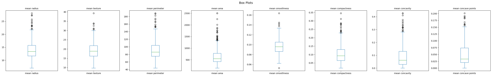
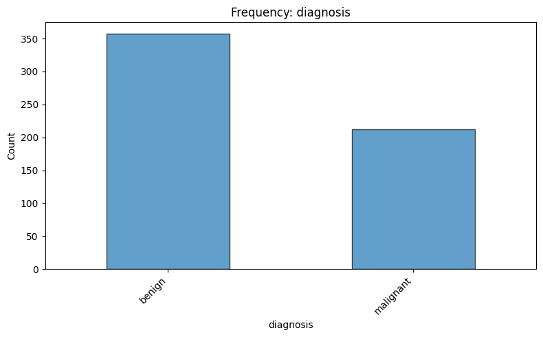
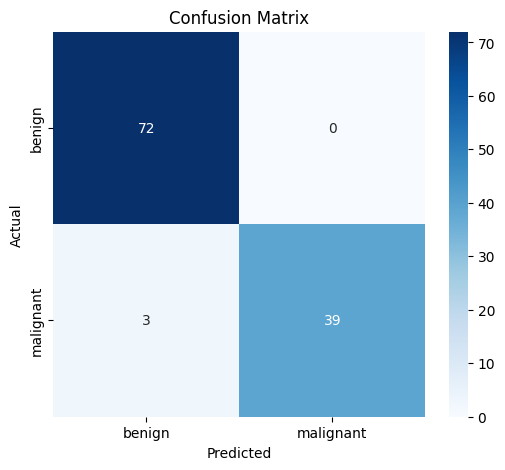
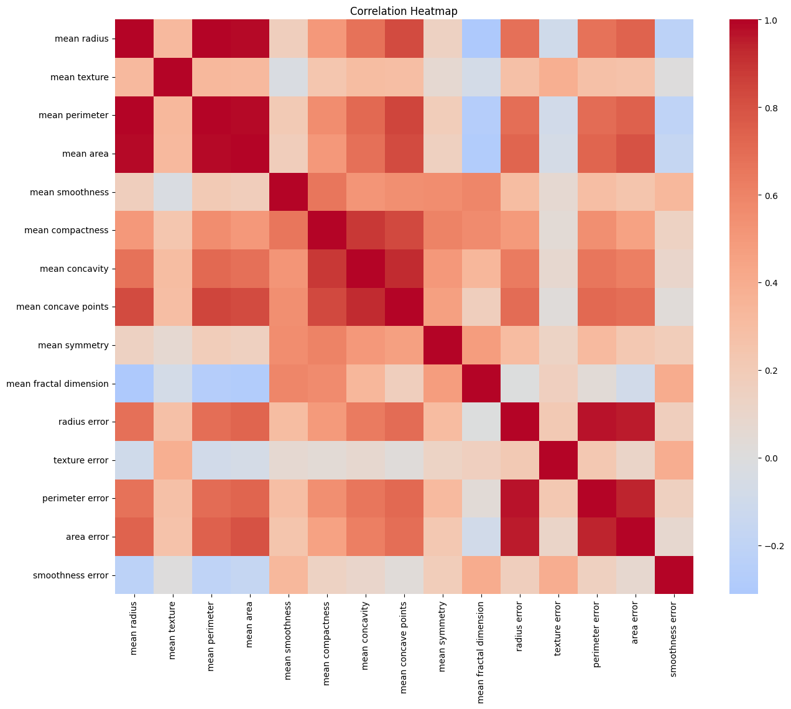
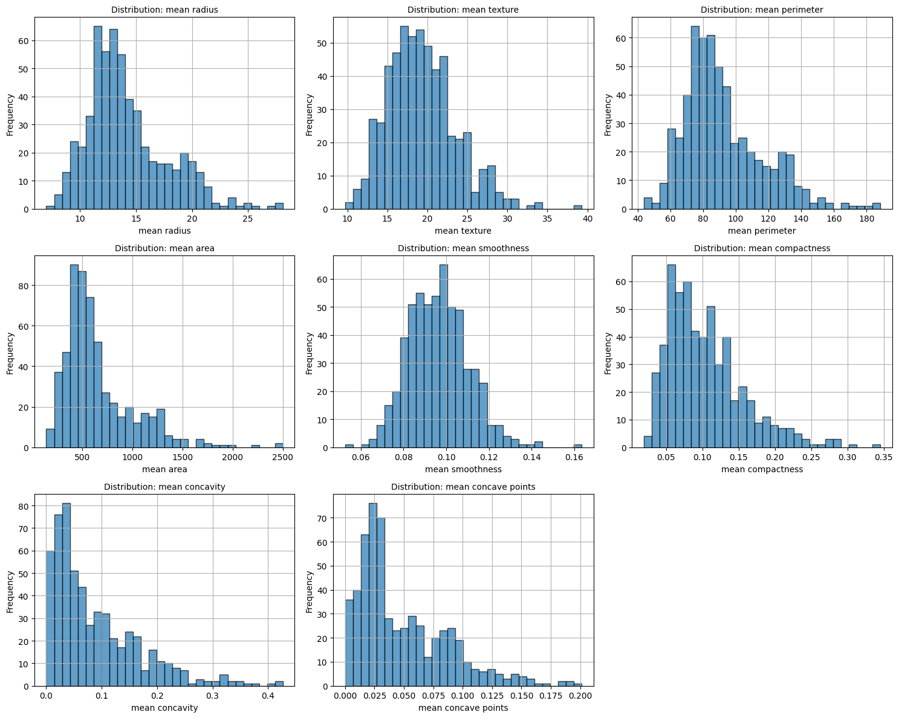
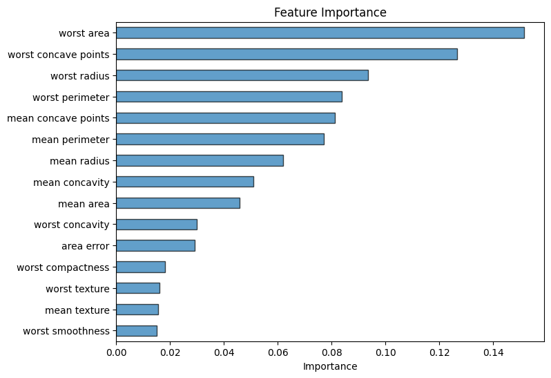

# Data Analysis Report — breast_cancer.csv

*Generated: 2026-10-25 18:57:47*

> ℹ️ **[DEMONSTRATION MODE]** — Results generated using deterministic routines without an LLM.

## 1. Dataset Overview

- **File**: breast_cancer.csv
- **Rows**: 569
- **Columns**: 31
- **Column Names**: mean radius, mean texture, mean perimeter, mean area, mean smoothness, mean compactness, mean concavity, mean concave points, mean symmetry, mean fractal dimension, radius error, texture error, perimeter error, area error, smoothness error, compactness error, concavity error, concave points error, symmetry error, fractal dimension error, worst radius, worst texture, worst perimeter, worst area, worst smoothness, worst compactness, worst concavity, worst concave points, worst symmetry, worst fractal dimension
  *(and 1 more)*

## 2. Analysis Objective

Comprehensive exploratory data analysis with classification

## 3. Analysis Plan

- **data_overview**: Dataset shape, types, and preview
- **data_quality**: Missing values, duplicates, warnings
- **descriptive_stats**: Summary statistics for numeric columns
- **distributions**: Distribution plots for numeric columns
- **correlation_analysis**: Correlation matrix and heatmap
- **boxplots**: Box plots for numeric columns
- **ml_modeling**: Classification model for 'diagnosis'

## 4. Data Quality Findings

- ✅ No significant data quality issues detected.

## 5. Statistical Observations

### Descriptive Statistics

| Column | Mean | Std | Min | Max |
|--------|------|-----|-----|-----|
| mean radius | 14.1273 | 3.524 | 6.981 | 28.11 |
| mean texture | 19.2896 | 4.301 | 9.71 | 39.28 |
| mean perimeter | 91.969 | 24.299 | 43.79 | 188.5 |
| mean area | 654.8891 | 351.9141 | 143.5 | 2501.0 |
| mean smoothness | 0.0964 | 0.0141 | 0.0526 | 0.1634 |
| mean compactness | 0.1043 | 0.0528 | 0.0194 | 0.3454 |
| mean concavity | 0.0888 | 0.0797 | 0.0 | 0.4268 |
| mean concave points | 0.0489 | 0.0388 | 0.0 | 0.2012 |
| mean symmetry | 0.1812 | 0.0274 | 0.106 | 0.304 |
| mean fractal dimension | 0.0628 | 0.0071 | 0.05 | 0.0974 |
| radius error | 0.4052 | 0.2773 | 0.1115 | 2.873 |
| texture error | 1.2169 | 0.5516 | 0.3602 | 4.885 |
| perimeter error | 2.8661 | 2.0219 | 0.757 | 21.98 |
| area error | 40.3371 | 45.491 | 6.802 | 542.2 |
| smoothness error | 0.007 | 0.003 | 0.0017 | 0.0311 |
| compactness error | 0.0255 | 0.0179 | 0.0023 | 0.1354 |
| concavity error | 0.0319 | 0.0302 | 0.0 | 0.396 |
| concave points error | 0.0118 | 0.0062 | 0.0 | 0.0528 |
| symmetry error | 0.0205 | 0.0083 | 0.0079 | 0.079 |
| fractal dimension error | 0.0038 | 0.0026 | 0.0009 | 0.0298 |

## 6. Visualizations

### Boxplots

### Categorical Diagnosis

### Confusion Matrix

### Correlation Heatmap

### Distributions

### Feature Importance

## 8. Limitations

- This analysis is automated and may miss domain-specific nuances.
- Results were generated in demonstration mode without an LLM.
- Analysis steps are deterministic and may not be optimally tailored.
- Correlation does not imply causation.
- ML metrics are computed on a held-out test set but may not generalize to new data.

## 10. Conclusion

- **Review Status**: accepted
- **Decision**: Analysis completed successfully. All planned steps produced output.
- **Completed**: data_overview, data_quality, descriptive_stats, distributions, correlation_analysis, boxplots, ml_modeling
