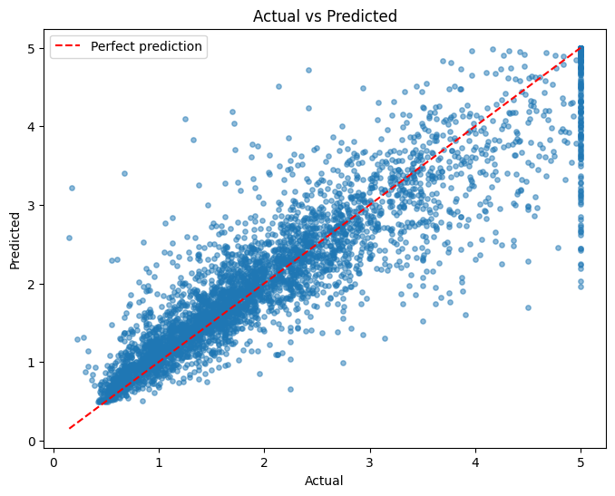
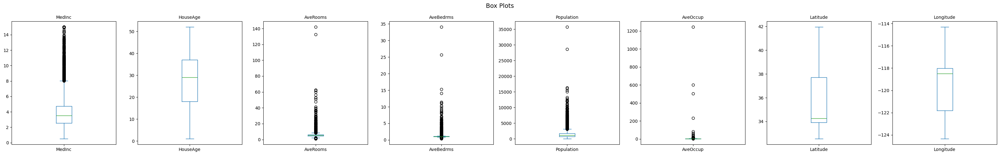
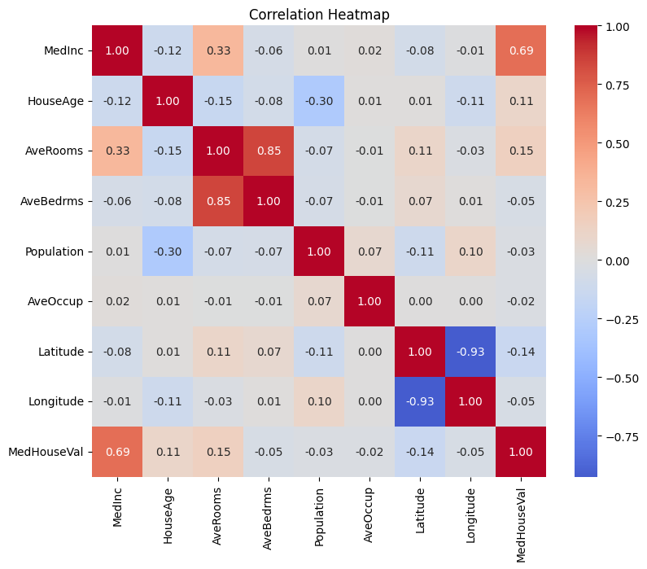
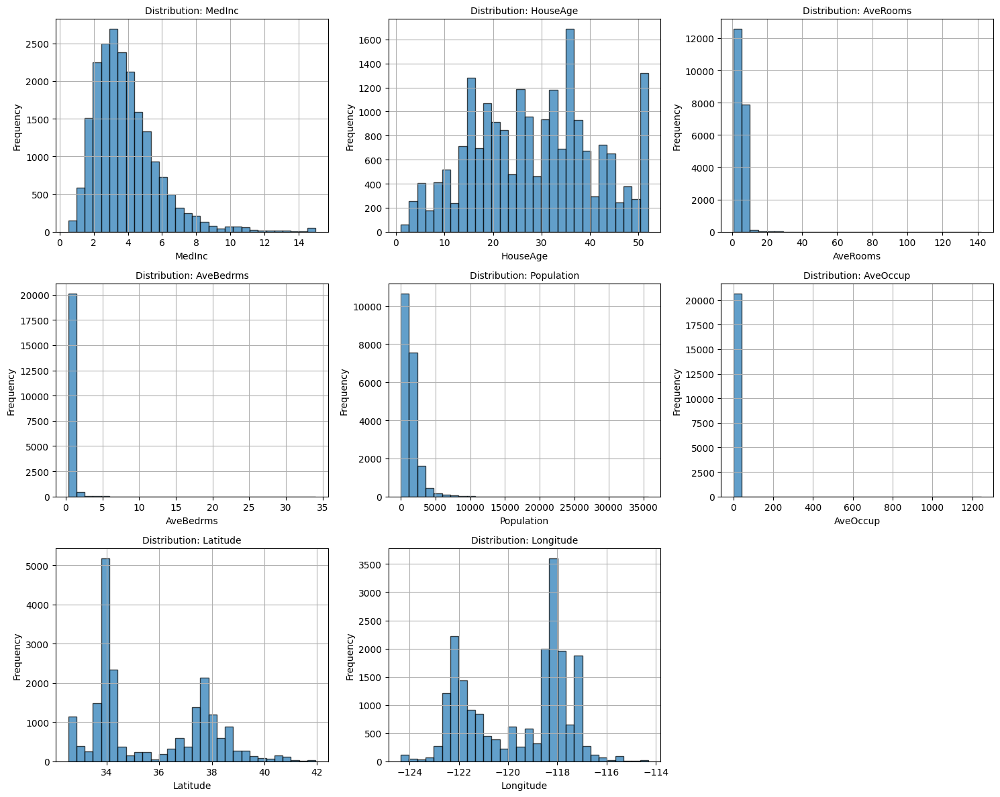
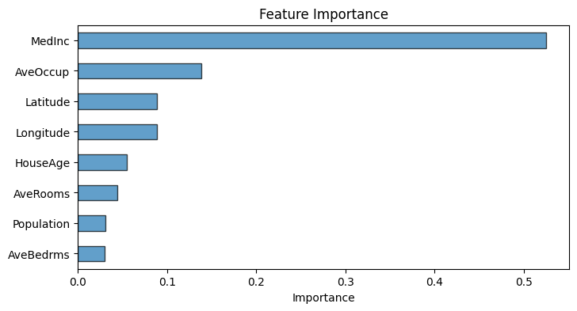
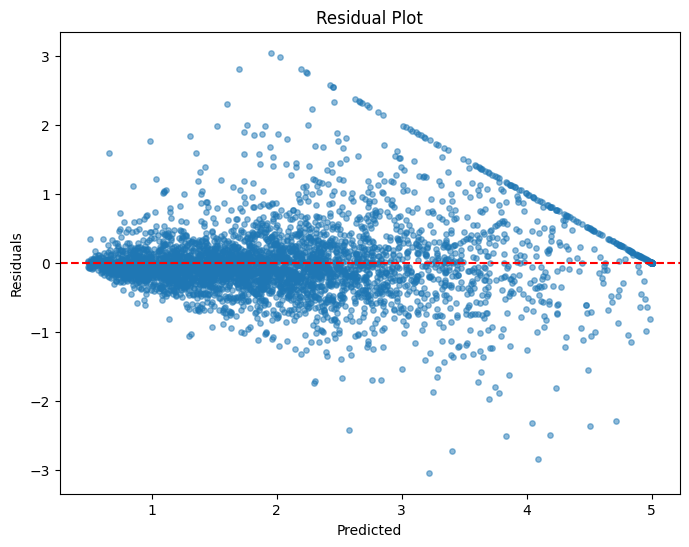

# Data Analysis Report — california_housing.csv

*Generated: 2026-10-25 18:57:52*

> ℹ️ **[DEMONSTRATION MODE]** — Results generated using deterministic routines without an LLM.

## 1. Dataset Overview

- **File**: california_housing.csv
- **Rows**: 20,640
- **Columns**: 9
- **Column Names**: MedInc, HouseAge, AveRooms, AveBedrms, Population, AveOccup, Latitude, Longitude, MedHouseVal

## 2. Analysis Objective

Comprehensive exploratory data analysis with regression

## 3. Analysis Plan

- **data_overview**: Dataset shape, types, and preview
- **data_quality**: Missing values, duplicates, warnings
- **descriptive_stats**: Summary statistics for numeric columns
- **distributions**: Distribution plots for numeric columns
- **correlation_analysis**: Correlation matrix and heatmap
- **boxplots**: Box plots for numeric columns
- **ml_modeling**: Regression model for 'MedHouseVal'

## 4. Data Quality Findings

- ✅ No significant data quality issues detected.

## 5. Statistical Observations

### Descriptive Statistics

| Column | Mean | Std | Min | Max |
|--------|------|-----|-----|-----|
| MedInc | 3.8707 | 1.8998 | 0.4999 | 15.0001 |
| HouseAge | 28.6395 | 12.5856 | 1.0 | 52.0 |
| AveRooms | 5.429 | 2.4742 | 0.8462 | 141.9091 |
| AveBedrms | 1.0967 | 0.4739 | 0.3333 | 34.0667 |
| Population | 1425.4767 | 1132.4621 | 3.0 | 35682.0 |
| AveOccup | 3.0707 | 10.386 | 0.6923 | 1243.3333 |
| Latitude | 35.6319 | 2.136 | 32.54 | 41.95 |
| Longitude | -119.5697 | 2.0035 | -124.35 | -114.31 |
| MedHouseVal | 2.0686 | 1.154 | 0.15 | 5.0 |

## 6. Visualizations

### Actual Vs Predicted

### Boxplots

### Correlation Heatmap

### Distributions

### Feature Importance

### Residual Plot

## 8. Limitations

- This analysis is automated and may miss domain-specific nuances.
- Results were generated in demonstration mode without an LLM.
- Analysis steps are deterministic and may not be optimally tailored.
- Correlation does not imply causation.
- ML metrics are computed on a held-out test set but may not generalize to new data.

## 10. Conclusion

- **Review Status**: accepted
- **Decision**: Analysis completed successfully. All planned steps produced output.
- **Completed**: data_overview, data_quality, descriptive_stats, distributions, correlation_analysis, boxplots, ml_modeling
