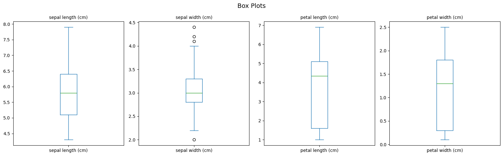
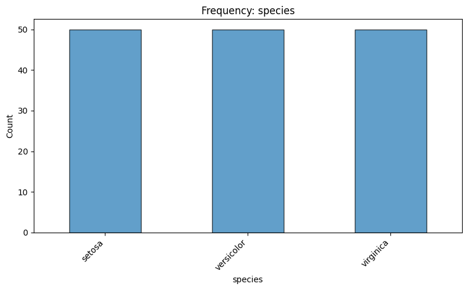
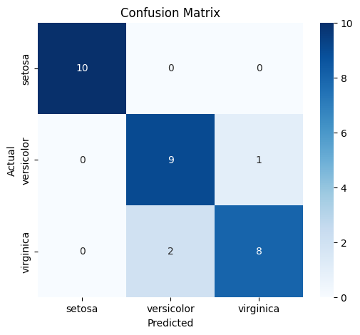
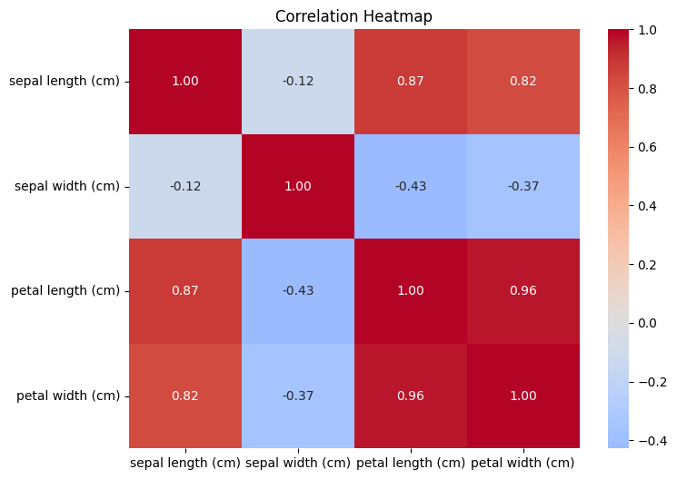
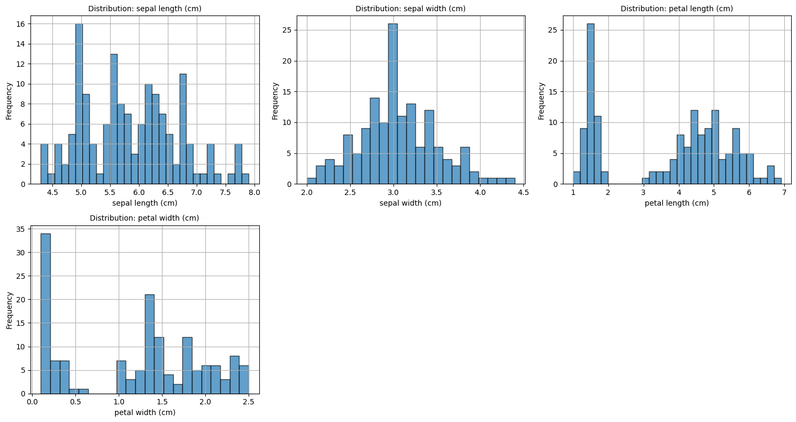
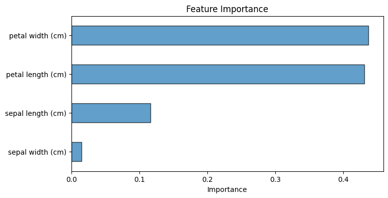

# Data Analysis Report — iris.csv

*Generated: 2026-10-25 18:57:34*

> ℹ️ **[DEMONSTRATION MODE]** — Results generated using deterministic routines without an LLM.

## 1. Dataset Overview

- **File**: iris.csv
- **Rows**: 150
- **Columns**: 5
- **Column Names**: sepal length (cm), sepal width (cm), petal length (cm), petal width (cm), species

## 2. Analysis Objective

Comprehensive exploratory data analysis with classification

## 3. Analysis Plan

- **data_overview**: Dataset shape, types, and preview
- **data_quality**: Missing values, duplicates, warnings
- **descriptive_stats**: Summary statistics for numeric columns
- **distributions**: Distribution plots for numeric columns
- **correlation_analysis**: Correlation matrix and heatmap
- **boxplots**: Box plots for numeric columns
- **ml_modeling**: Classification model for 'species'

## 4. Data Quality Findings

- ⚠️ 1 duplicate rows (0.7%)

- **Duplicate rows**: 1

## 5. Statistical Observations

### Descriptive Statistics

| Column | Mean | Std | Min | Max |
|--------|------|-----|-----|-----|
| sepal length (cm) | 5.8433 | 0.8281 | 4.3 | 7.9 |
| sepal width (cm) | 3.0573 | 0.4359 | 2.0 | 4.4 |
| petal length (cm) | 3.758 | 1.7653 | 1.0 | 6.9 |
| petal width (cm) | 1.1993 | 0.7622 | 0.1 | 2.5 |

## 6. Visualizations

### Boxplots

### Categorical Species

### Confusion Matrix

### Correlation Heatmap

### Distributions

### Feature Importance

## 8. Limitations

- This analysis is automated and may miss domain-specific nuances.
- Results were generated in demonstration mode without an LLM.
- Analysis steps are deterministic and may not be optimally tailored.
- Correlation does not imply causation.
- ML metrics are computed on a held-out test set but may not generalize to new data.

## 10. Conclusion

- **Review Status**: accepted
- **Decision**: Analysis completed successfully. All planned steps produced output.
- **Completed**: data_overview, data_quality, descriptive_stats, distributions, correlation_analysis, boxplots, ml_modeling
