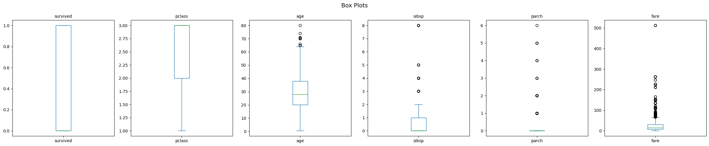
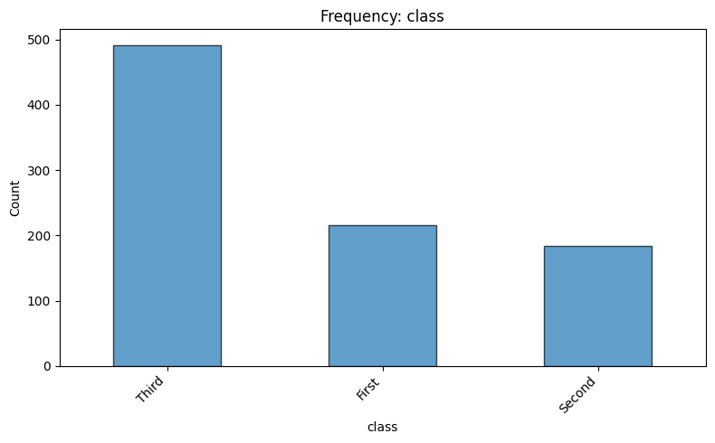
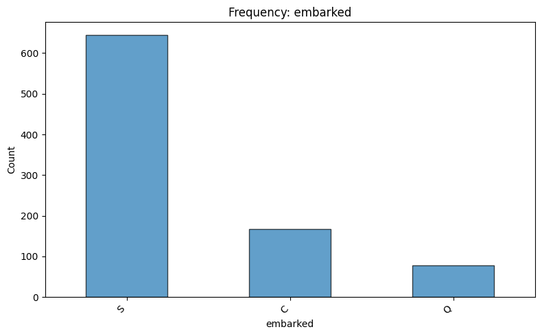
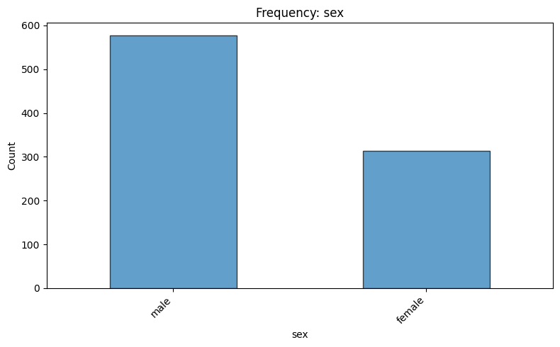
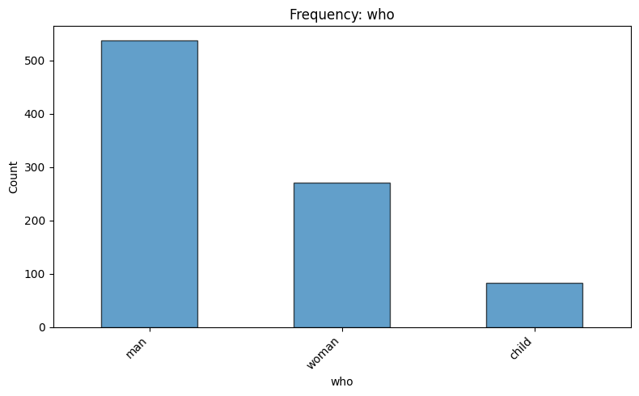
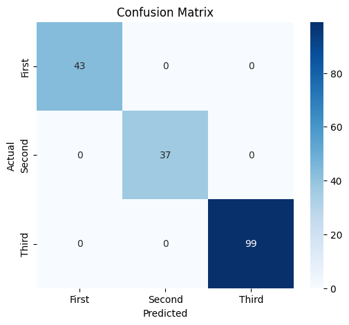
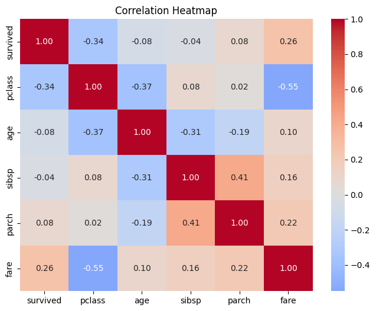
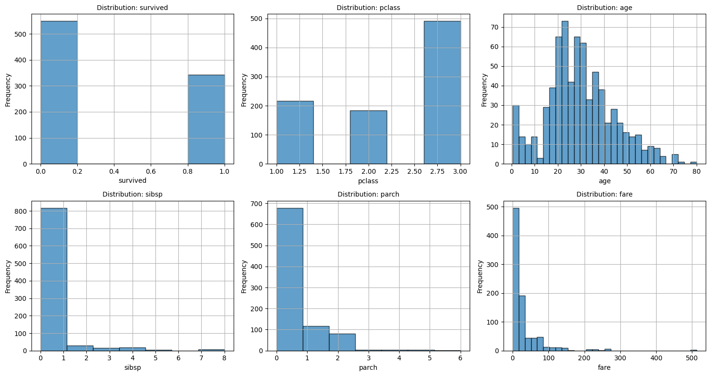
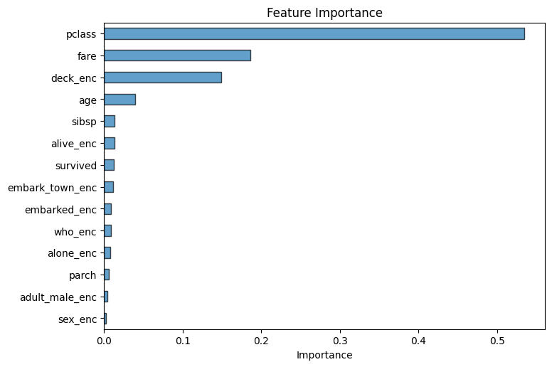

# Data Analysis Report — titanic.csv

*Generated: 2026-10-25 18:57:38*

> ℹ️ **[DEMONSTRATION MODE]** — Results generated using deterministic routines without an LLM.

## 1. Dataset Overview

- **File**: titanic.csv
- **Rows**: 891
- **Columns**: 15
- **Column Names**: survived, pclass, sex, age, sibsp, parch, fare, embarked, class, who, adult_male, deck, embark_town, alive, alone

## 2. Analysis Objective

Comprehensive exploratory data analysis with classification

## 3. Analysis Plan

- **data_overview**: Dataset shape, types, and preview
- **data_quality**: Missing values, duplicates, warnings
- **descriptive_stats**: Summary statistics for numeric columns
- **distributions**: Distribution plots for numeric columns
- **correlation_analysis**: Correlation matrix and heatmap
- **boxplots**: Box plots for numeric columns
- **categorical_analysis**: Frequency analysis of categorical columns
- **ml_modeling**: Classification model for 'class'

## 4. Data Quality Findings

- ⚠️ High missing values (>50%): deck
- ⚠️ 107 duplicate rows (12.0%)

### Missing Values

| Column | Missing | % |
|--------|---------|---|
| deck | 688 | 77.2% |
| age | 177 | 19.9% |
| embarked | 2 | 0.2% |
| embark_town | 2 | 0.2% |

- **Duplicate rows**: 107

## 5. Statistical Observations

### Descriptive Statistics

| Column | Mean | Std | Min | Max |
|--------|------|-----|-----|-----|
| survived | 0.3838 | 0.4866 | 0.0 | 1.0 |
| pclass | 2.3086 | 0.8361 | 1.0 | 3.0 |
| age | 29.6991 | 14.5265 | 0.42 | 80.0 |
| sibsp | 0.523 | 1.1027 | 0.0 | 8.0 |
| parch | 0.3816 | 0.8061 | 0.0 | 6.0 |
| fare | 32.2042 | 49.6934 | 0.0 | 512.3292 |

## 6. Visualizations

### Boxplots

### Categorical Class

### Categorical Embarked

### Categorical Sex

### Categorical Who

### Confusion Matrix

### Correlation Heatmap

### Distributions

### Feature Importance

## 8. Limitations

- This analysis is automated and may miss domain-specific nuances.
- Results were generated in demonstration mode without an LLM.
- Analysis steps are deterministic and may not be optimally tailored.
- Correlation does not imply causation.
- ML metrics are computed on a held-out test set but may not generalize to new data.

## 10. Conclusion

- **Review Status**: accepted
- **Decision**: Analysis completed successfully. All planned steps produced output.
- **Completed**: data_overview, data_quality, descriptive_stats, distributions, correlation_analysis, boxplots, categorical_analysis, ml_modeling
