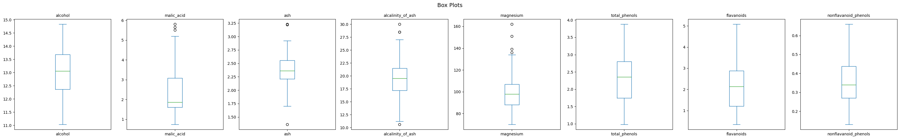
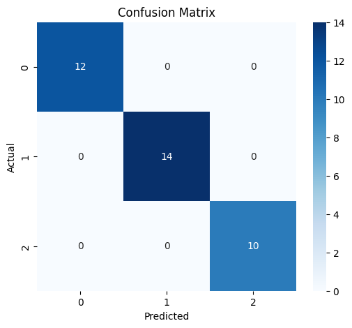
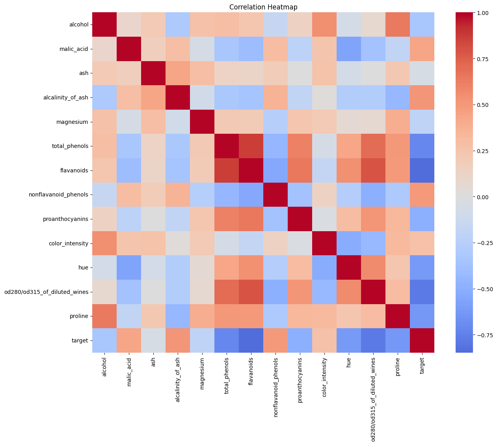
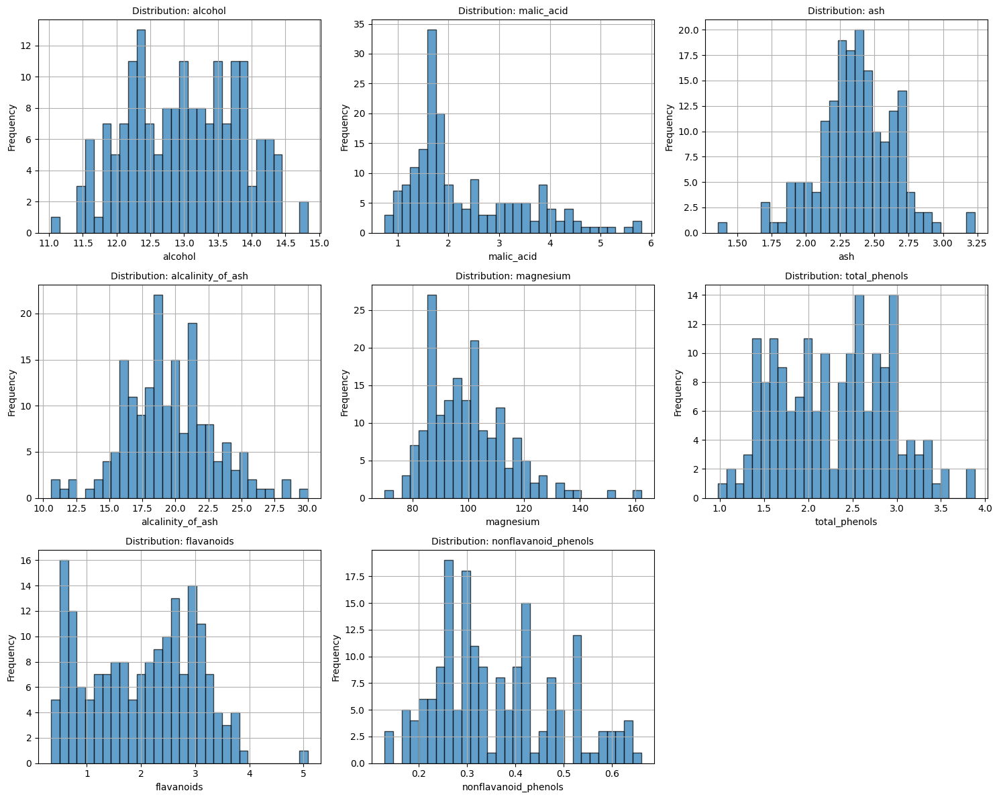
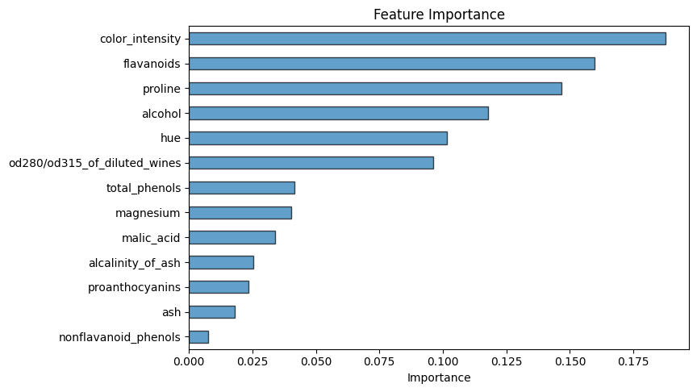

# Data Analysis Report — wine.csv

*Generated: 2026-10-25 18:57:42*

> ℹ️ **[DEMONSTRATION MODE]** — Results generated using deterministic routines without an LLM.

## 1. Dataset Overview

- **File**: wine.csv
- **Rows**: 178
- **Columns**: 14
- **Column Names**: alcohol, malic_acid, ash, alcalinity_of_ash, magnesium, total_phenols, flavanoids, nonflavanoid_phenols, proanthocyanins, color_intensity, hue, od280/od315_of_diluted_wines, proline, target

## 2. Analysis Objective

Comprehensive exploratory data analysis with classification

## 3. Analysis Plan

- **data_overview**: Dataset shape, types, and preview
- **data_quality**: Missing values, duplicates, warnings
- **descriptive_stats**: Summary statistics for numeric columns
- **distributions**: Distribution plots for numeric columns
- **correlation_analysis**: Correlation matrix and heatmap
- **boxplots**: Box plots for numeric columns
- **ml_modeling**: Classification model for 'target'

## 4. Data Quality Findings

- ✅ No significant data quality issues detected.

## 5. Statistical Observations

### Descriptive Statistics

| Column | Mean | Std | Min | Max |
|--------|------|-----|-----|-----|
| alcohol | 13.0006 | 0.8118 | 11.03 | 14.83 |
| malic_acid | 2.3363 | 1.1171 | 0.74 | 5.8 |
| ash | 2.3665 | 0.2743 | 1.36 | 3.23 |
| alcalinity_of_ash | 19.4949 | 3.3396 | 10.6 | 30.0 |
| magnesium | 99.7416 | 14.2825 | 70.0 | 162.0 |
| total_phenols | 2.2951 | 0.6259 | 0.98 | 3.88 |
| flavanoids | 2.0293 | 0.9989 | 0.34 | 5.08 |
| nonflavanoid_phenols | 0.3619 | 0.1245 | 0.13 | 0.66 |
| proanthocyanins | 1.5909 | 0.5724 | 0.41 | 3.58 |
| color_intensity | 5.0581 | 2.3183 | 1.28 | 13.0 |
| hue | 0.9574 | 0.2286 | 0.48 | 1.71 |
| od280/od315_of_diluted_wines | 2.6117 | 0.71 | 1.27 | 4.0 |
| proline | 746.8933 | 314.9075 | 278.0 | 1680.0 |
| target | 0.9382 | 0.775 | 0.0 | 2.0 |

## 6. Visualizations

### Boxplots

### Confusion Matrix

### Correlation Heatmap

### Distributions

### Feature Importance

## 8. Limitations

- This analysis is automated and may miss domain-specific nuances.
- Results were generated in demonstration mode without an LLM.
- Analysis steps are deterministic and may not be optimally tailored.
- Correlation does not imply causation.
- ML metrics are computed on a held-out test set but may not generalize to new data.

## 10. Conclusion

- **Review Status**: accepted
- **Decision**: Analysis completed successfully. All planned steps produced output.
- **Completed**: data_overview, data_quality, descriptive_stats, distributions, correlation_analysis, boxplots, ml_modeling
